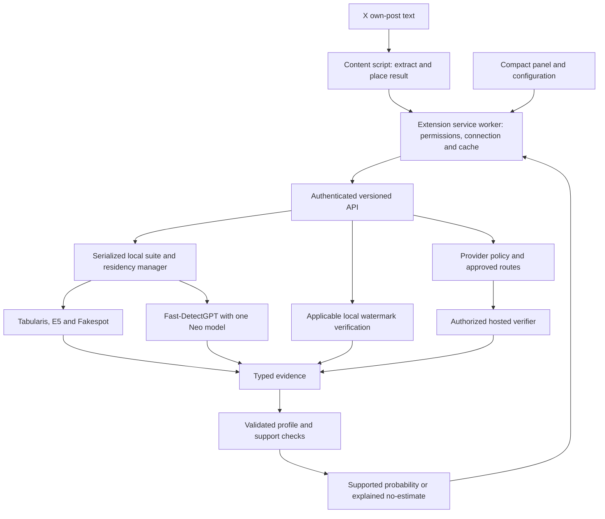

# Multi-detector implementation plan

**Planning authorized:** the user approved design decisions **A–H** with “approve a-h.” This document is the next deliverable authorized by H. **Implementation and deployment have not started under this approval.** Provider applications, paid usage, contributor/data-sharing agreements, off-server submissions, and changes to remote services remain separately authorized actions.

The [approved design brief](design-brief.md#7-specific-decisions-for-approval) is the product baseline. The [current-state record](requirements-and-state.md) describes what actually exists. Phase checklists below are future work, not completed results.

**Subsequent implementation authorization:** the user explicitly requested implementation of item 1, the versioned API/evidence contract. That slice now exists with fake-suite tests; see [the implemented contract and limitations](v2-api.md). No real suite/provider/extension implementation or deployment was authorized by that request. The lightweight local test dependency set is pinned and fresh-environment tested; a Linux inference lock and actual GPU runtime integration remain unverified.

**Phase-2 update:** the user then separately requested the local-suite/residency phase. It is implemented and [tested through the real 3060 API](suite-runtime.md), with shared v1/v2 ownership, idle/manual controls, and restart pause. Linux dependency versions are captured as an observed snapshot, not a hash-locked fresh-install proof. Subsequent watermark/provider, extension, scoring, and deployment work remains open. The phase descriptions below are the plan; use the runtime record for completed evidence.

**Phase-3 update:** the user explicitly requested watermark routes/policy. The [conditional CPU verifier and disabled provider registry](watermark-routes.md) are implemented, including a watermark-only API and scoped/full-suite tests. No provider application, real access grant, callable hosted adapter, or off-server route activation was obtained/authorized by this work. Chrome, calibration, and deployment remain subsequent phases.

**Phase-4 update:** the user separately requested the thin Chrome extension. The [MV3 research client](extension.md) is implemented with 30 Node tests and a real Chrome/synthetic-page/API smoke. Manual native-permission/live-X and real-GPU end-to-end acceptance remain open. Calibration, provider access/activation, deployment, and store publication were not authorized by this slice.

**Subsequent private-deployment approval:** the user explicitly approved the proposed LAN/Tailscale-only `slop-detection.dimensionlab.net` endpoint. The [persistent research service](private-deployment.md) is now deployed, with actual Chrome/private-HTTPS/3060 validation and a cold-import status fix. This separate authorization does not waive scoring/provider launch gates, authorize public exposure, or make the research client a validated product. Earlier approval/update paragraphs are chronological records.

**Scoring implementation update:** the user then requested the combined scoring/validation step and explicitly authorized temporary shared-service resume for the pilot. The [offline pipeline](scoring.md) collected 818 real evidence records and fitted/froze/evaluated nine candidates; exact evaluation reproduced. [Measured results](scoring-pilot-results.md) did not establish ensemble benefit or pass release gates. Shared pause/unload was restored. No API/UI percentage activation or scoring deployment occurred; product validation remains incomplete.

**Contributor-study preparation:** following benchmark safeguards/intake work, the user agreed to pursue a contributor study. The [concrete pilot proposal](contributor-study.md) now includes costed staged recruitment, draft consent/retention/reviewer material, offline preparation and preassigned quota slots. No paid commitment, account action, participant contact, public collection deployment or full-study commission has been made; exact budget/controller/terms/hosting decisions remain explicit.

## 1. Outcome and non-negotiable boundaries

Build a thin Chrome extension and a dedicated analysis service:

- Local inference on the passive **RTX 3060**, with explicit CPU configurations where appropriate; no automatic use of the active 3090.
- Validate **Tabularis + E5 + Fakespot + single-Neo Fast-DetectGPT**; TMR is a controlled challenger. Add applicable local and authorized provider watermark checks as distinct evidence sources.
- Lazy loading, configurable **600-second default** idle unload, one-click Load/Unload, and shared server state. Manual unload pauses automatic reloading until authenticated Load; idle unload does not.
- Compact toolbar control panel and cogwheel configuration dialog. Own-post text only, quoted posts separate; discreet header result before Grok/menu buttons, no hiding/fading.
- A percentage targets **substantive generated/rewritten wording**, including translation and retained mixed writing. No averaging, manual probability weights, or p-value conversion.
- No unvalidated combined feed percentage. Use explained `—` states and labeled native diagnostics while validation is incomplete. A validated, approved profile is required for a number.
- Local-server processing by default; no background provider submissions without route-specific approval. Provider credentials never reach the extension.

**Two independent launch gates:** provider verification/access and acceptable coverage (B), and target-aligned score/coverage validation (C–E). Passing one does not waive the other. A working local research extension is not the completed requested product.

## 2. Architecture and deliberate simplifications

Use the existing FastAPI service, adapter boundary, and cancellation-safe residency work rather than a second inference server or a general job platform. Initially keep **one server worker and one bounded local execution slot**, with sequential GPU work. Co-residency is supported by the bounded probes; simultaneous CUDA streams and multiple model-owning web workers are not needed.

Implement a small suite adapter/orchestrator with explicit component contracts. The current lifecycle validation assumes every prediction is a finite probability in `[0, 1]`; replace that assumption with typed evidence checks. Neo's discrepancy must not be squeezed into the classifier shape. Reuse the existing lock/ownership and cancellation safety, not its single-model semantics unchanged.

Local watermark tasks must also be bounded and coordinated with unloading if they own resident assets. Approved hosted requests use bounded async I/O outside the GPU ownership lock, with deadlines and per-route limits; they must not keep GPU models resident merely because a network request is slow. Manual pause stops new analysis and provider submissions, not just GPU loading.

For the extension, prefer plain Manifest V3 JavaScript, HTML, and CSS: no UI framework, model runtime, or bundler unless a demonstrated need appears. Keep model selection, calibration, route policy, and secrets authoritative on the server. Do not let arbitrary page messages choose an endpoint, model, key, or probability weight.

### Versioned evidence/result contract

Define and test the contract before implementing additional adapters:

| Part | Required content |
| --- | --- |
| Request | Bounded batch of client IDs and original own-post text; extraction version. Do not require usernames, timelines, cookies, or attached media. The client cannot enable a provider by request. |
| Per-check evidence | Checker/config/model revision, native output kind/value, token/input coverage, and status/reason. Keep `completed`, `unavailable`, `unsupported`, `insufficient_evidence`, `failed`, and `timed_out` distinct; watermark completed results retain detected/not-detected/inconclusive meaning. |
| Aggregate | Target/profile ID, schema/config generation, support/calibration scope, and either a probability or a specific no-estimate reason. Missing evidence is not zero. |
| Service state | Per-component residency, selected GPU identity, shared manual pause, control-operation progress, idle interval/countdown, route applicability/access/approval, and scoring-profile readiness. “Models loaded” and “probability validated” are different readiness claims. |
| Privacy | No submitted text echoed in validation errors or default logs, no secrets in status, and no persistent text collection by default. |

Plan a **v2 API** for these changed semantics; retain v1 only as explicitly labeled legacy Tabularis diagnostics during migration. The extension must negotiate the supported version and reject incompatible responses, never fall back to v1's `ai_percentage` as the new score. Keep authenticated health/liveness separate from model readiness and profile support. Exact v2 route names and payload examples are the first implementation deliverable, not existing endpoints.

Invalid envelopes still receive bounded HTTP errors. Valid batches should preserve per-post/per-check failures rather than discard every result because one post is overlength. Readiness must identify required component failures; a partial load cannot silently select a smaller profile.

## 3. Phased work and acceptance criteria

### Phase 1 — Contract, reproducibility, and safety baseline

**Work**

- Define v2 request/evidence/status/control fixtures, no-estimate reasons, readiness, and v1 migration behavior.
- Centralize model/checker specifications: reviewed revisions, label mappings, token limits, precision, preprocessing, and licenses. Separate production-eligible configurations from controlled research fixtures.
- Capture a reproducible tested dependency set for local development and the Linux GPU host; current broad dependency ranges are not a reproducibility record.
- Specify bounded input bytes, batch sizes, token-based admission, execution slots, provider timeouts, and safe error envelopes. Preserve authentication-before-body handling and sanitized failures.

**Acceptance**

- Contract tests cover malformed/unauthenticated/oversized input, unsupported schema, mixed-success batches, native output types, and absence of a probability without a validated profile.
- Fresh install instructions and license/notice records identify the exact assets used. No optional heavy import or model allocation is needed for liveness or lightweight contract tests.

### Phase 2 — Real local suite and shared residency

**Work**

- Convert the measured classifier and Neo configurations into production adapters, not a wrapper around the entire diagnostic script. Preserve label index mappings, raw-text evidence, finite-output checks, and Neo's single-model/two-role analytic calculation. Keep TMR selectable for experiments, not default extra voting.
- Enforce each check's token contract without silent truncation, normalization, or padding from other posts. Start with the **tested 512-token cap**; longer-input scheduling/chunking is a separate change requiring evaluation.
- Select the 3060 by UUID before CUDA initialization and confirm its identity. Refuse an unavailable/wrong GPU rather than spill to the 3090. Record explicit CPU/precision profiles separately; do not silently reuse GPU thresholds on CPU Neo outputs.
- Extend residency to all selected local assets, clean up partial loads, and keep status responsive during work. No automatic heavy loading on status/health polls.
- Manual Unload latches shared pause before new admission, allows already-owned uncancellable work to finish safely, then releases assets. At most one pending control transition, not an unbounded inference/control queue. Return immediate acknowledgement/progress for pending work; duplicate controls are idempotent and conflicting controls explicit.
- Load clears pause and loads the selected suite. Idle unload after 600 seconds by default permits the next analysis to reload. Persist the non-secret manual-pause intent so a service restart does not undo an explicit Unload. Never reload due to status polling alone.

**Acceptance**

- Fake-adapter tests cover partial load failure, exceptions, cancelled/disconnected clients, idle expiry, unload while busy, competing Load/Unload, shutdown, restart pause intent, and two clients observing the same state.
- Real 3060 API tests produce all four native outputs with pinned configurations; unload/reload affects the whole suite. Account separately for live tensors, allocator blocks, and residual CUDA context; do not claim zero process VRAM unless measured.
- Mixed long/short and low-evidence batches produce explicit statuses; repeated load/unload does not leak model allocations. OOM enters a visible failure/recovery path, not an unannounced reduced suite or 3090 fallback.

### Phase 3 — Conditional watermark and provider-policy framework

**Work**

- Implement one pinned KGW-style verification adapter based on the tested path, with exact configuration/tokenizer identity and applicability rules. Keep demo-key fixtures explicitly research-only. With no justified matching configuration for a post, report the route as inapplicable/unsupported, not a negative.
- Preserve original text for verification, native statistics, and implementation limitations. Define multiple-testing behavior before expanding to multiple keys/schemes/windows.
- Add a small route registry/policy boundary: discovered, access pending, configured, approved/enabled, unsupported, failed. No speculative callable provider URL or guessed API schema.
- Keep provider routes disabled and show their access blockers until the separate access track below succeeds. Route approval is server-managed; a client scanning toggle or stored key alone cannot authorize off-server submission.

**Acceptance**

- Known marked/unmarked-AI/wrong-key/copy-paste fixtures pass; detector-only verification requires no generator model. These fixtures do not validate real-world authorship accuracy.
- Default analysis produces **zero hosted-verifier calls**. Disabled, unavailable, or inapplicable routes are never counted as human evidence.
- A later approved adapter must have tests for authentication, quotas, deadlines, errors, retention policy, applicability, and safe response mapping using the actual provider contract. Until then it is not reported as connected.

### Phase 4 — Thin extension and revised compact dialogs

**Work**

- Build Manifest V3 content extraction, background transport, local settings, and bounded in-memory result/request deduplication. Request only X/Twitter page access, storage, and the chosen server origin as needed; no broad mandatory access to unrelated websites, cookies, or browsing history.
- Keep the server credential in extension-local storage/background context, not sync, page DOM, content-script messages, or logs. The page cannot supply server URLs or privileged control requests. Validate message senders and response types; render text safely.
- Extract each visible post's own text, exclude quoted cards, preserve Unicode/line breaks for evidence, and tie results to exact text and extraction/profile/config versions. Handle scrolling, edits, reused DOM nodes, and navigation without scoring the wrong post.
- Place one discreet percentage or explained `—` before the existing header controls. Keep native diagnostics reachable in the control panel rather than introducing extra feed badges. Do not show v1 scores as combined percentages.
- Revise the old UI concepts before calling them final. Panel: connection, shared model/pause state, scanning control, quick Load/Unload, progress/errors, and cogwheel. Configuration: connection/test, active profile and limitations, component status, provider access/applicability/approval and data destination, idle policy, and failure explanations. Use collapsible sections within the small dialog flow, not a large dashboard.
- Keep configuration ownership clear: connection and scanning preference are client-local; idle policy and provider credentials/approval are server-managed and read-only unless a specifically secured operator setting is later added. No probability-weight sliders or arbitrary checker toggles that silently change the profile.
- Bound visible-post queues and debounce retries. Pause stops new background scans; busy/rate-limit handling uses bounded backoff. Key caches by exact text and server profile/config identity, with bounded size/TTL; invalidate on edits/profile changes. Persist no post texts by default.

**Acceptance**

- Synthetic DOM fixtures cover quoted/nested posts, emoji, multiline text, empty/media-only posts, edited/recycled nodes, and missing header anchors. Do not place a result on the wrong post if X changes its markup.
- Unit tests cover transport/version rejection, permissions, unauthorized page messages, retry limits, cache invalidation, and no-number behavior.
- Manual **Chrome** tests verify the actual toolbar → panel → cogwheel flow, keyboard/focus/error states, permission requests, offline/auth failure, two-client shared pause, and controls while loading/busy.
- Live X smoke tests use the user's agreed testing workflow with hosted routes disabled; no collected timeline or text retained. The research extension may show diagnostics/`—` before scoring gates pass and is explicitly not feature-complete.

### Phase 5 — Evaluation, fusion, and calibrated profiles

**Work**

- Execute the [approved evaluation direction](evaluation.md) once collection permissions/terms are settled: process-backed human/AI/mixed labels, pilot, lawful source registry, group-safe development/calibration/operating/final splits, and unseen-generator challenge.
- Compare each detector, the roster, leave-one-out ablations, and TMR replacement on identical eligible inputs. Use pilot evidence to agree numerical minimum recall/coverage and full study size **before** opening the final holdout.
- Fit regularized logistic stacking, then separate sigmoid calibration where justified. Preserve unknown labels and per-cohort results; validate each permitted missing-checker/CPU/precision profile rather than renormalizing whatever responds.
- Register a scoring artifact containing target definition, exact inputs/versions/transforms, fitted parameters, support/availability rules, thresholds, calibration population/assumptions, evidence report, and artifact hash. Reject incompatible or absent artifacts.
- Keep provider watermark positives/negatives out of learned production fusion until representative applicable data and actual access exist. A synthetic known-key fixture cannot teach provider-wide fusion weights.

**Acceptance**

- Held-out report includes achieved FPR with uncertainty, recall, coverage/abstentions, reliability/Brier/log loss, generator/length/language/edit cohorts, and incremental suite value/cost. The approved 0.5%/1% FPR operating targets are goals, not fabricated pass results.
- A profile produces a probability only inside its validated support and availability rules. Otherwise return no estimate and the native diagnostics.
- Resolve deployment-population/prevalence assumptions before a feed probability claim. Benchmark calibration alone cannot activate a universal X probability. If meaningful short-post coverage or additional-detector benefit fails, return the gap to the user rather than redefine completion.

### Phase 6 — End-to-end readiness, then separately approved deployment

**Work**

- Exercise the real v2 API, Chrome client, selected profile, manual/idle lifecycle, and all approved routes together. Measure extraction → response → placement, not only model inference.
- Repeat short-batch and near-limit measurements on the 3060; add sustained traffic, mixed-length batches, bounded concurrency, cancellation, slow providers, and competing-memory tests. Keep the earlier probe measurements as a baseline, not acceptance guarantees.
- Prepare a non-root, single-worker service/runbook: GPU pinning, protected secrets, authenticated HTTPS or an explicitly agreed secure private transport, bounded reverse-proxy timeouts/body limits, restart behavior, health checks, and rollback. Choose TLS/listen/firewall details after inspecting the intended deployment with permission. Never open an unauthenticated public inference port.
- Prepare a packaged extension, installation/update instructions, privacy/limitations, and release checks. Publishing to a store or changing a shared destination branch requires separate authorization.

**Acceptance**

- No active-3090 allocations; full-suite residency and release evidence recorded, including residual context. Busy/paused/failure states remain truthful throughout Chrome and server operations.
- No raw post text/credentials in default logs, browser-visible page state, error payloads, or public artifacts. Provider egress matches the enabled/approved route list.
- Provider coverage and score/coverage gates below are met or the user explicitly revises scope. Deployment starts only after its own authorization; a passing staging test is not permission to alter production services.

## 4. Parallel access/data tracks and external gates

These can progress alongside local adapter/UI work **once implementation is authorized**; they do not justify invented provider adapters or labels.

| Track | Next action | Gate before relying on it |
| --- | --- | --- |
| Anthropic/OpenAI | Prepare eligibility/questions from the recorded access routes for user review | Separate permission to apply/submit identity; access grant, real text contract, cost/quota/automation/retention acceptance, and live validation. |
| Google | Recheck authorized automated text-verification availability and contact route | Actual text capability/access, not image/audio support or a demo key. |
| xAI | Recheck the scheduled rollout and team-admin application requirements | Live coverage and approved access/terms; a future date or generation header is not a verifier. |
| Local watermark schemes | Identify legitimate matching configurations with real applicability | Source/asset rights, adapter compatibility, multiple-testing policy, and cohort evidence. |
| Evaluation collection | Agree contributor workflow, permissions, retention/withdrawal and private/public uses; test local generation separately | Actual provenance-backed material, not scraped “human” assumptions; consent and source rights before collection/sharing. |
| Scientific acceptance | Use pilot to size the study and agree minimum useful recall/coverage | Frozen thresholds/support rules and untouched held-out evidence; defensible deployment calibration. |

If no provider becomes available under acceptable terms, **stop at the launch gate**. Report exactly what is available and ask about access/scope; do not turn known-key research support into a claim of production signature coverage. Access to one provider also does not settle which provider/model coverage the user will accept.

## 5. Implementation order and review checkpoints

1. **First implementation slice:** v2 fixtures/contract, typed evidence, adapter specifications, and fake-suite tests. No model download is needed to review the semantics.
2. **Local vertical slice:** Phase 2 plus the applicable local-check path; real 3060 API test with hosted egress disabled. Review residency/failure evidence before wiring the extension.
3. **Research client:** Phase 4 against that contract; revise UI and test real Chrome/X behavior with diagnostic/no-estimate results.
4. **Evidence tracks:** pilot, provider access, and evaluation can overlap local work after their specific authorizations. No artificial schedule promises for gated access or corpus acquisition.
5. **Probability enablement:** Phase 5 and explicit supported-profile review; no numeric placeholder during earlier slices.
6. **Release review:** Phase 6 evidence plus user acceptance of provider/model coverage, probability scope, and remaining limitations; then request deployment/publication authorization.

Each slice should be independently reviewable with its changes, tests, remaining gates, and actual-versus-proposed state recorded. Completing a slice is not approval to remove a detector track or to launch.

### Validation commands and evidence

Retain `.venv/bin/python -m unittest discover -s tests -v` as the Python baseline and expand its fake-adapter/API/lifecycle coverage. Keep the real API smoke script distinct from standalone diagnostic probes. Update both when the v2 contract exists; the current smoke script proves only v1 Tabularis behavior.

Add extension unit/fixture tests runnable with `node --test` when that code exists. Use real Chrome for final extension validation; a DOM unit test or another browser is not the same check. Record exact host environment, model revisions, commands, input classes, counts, timings, failures, and 3060/3090 allocation checks for GPU validation.

**Checks for this planning deliverable only:** documentation consistency, relative links/anchors, and `git diff --check`. No new runtime, GPU, browser, provider, or accuracy result is implied by this plan.
